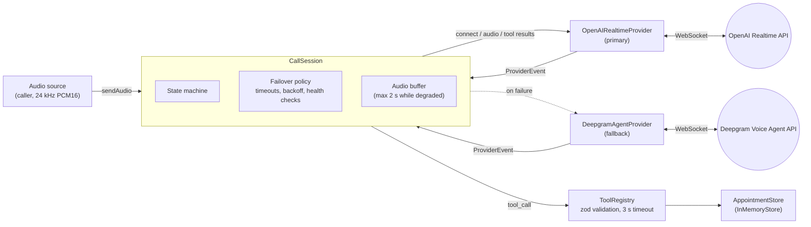
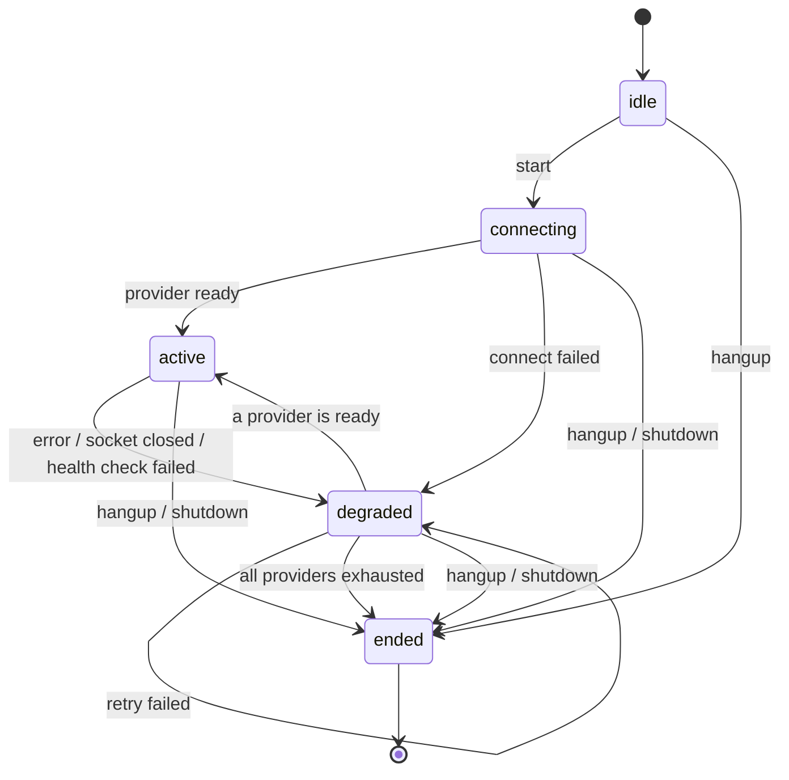

# voice-agent-reference

A **reference implementation**, not a product: the server-side core of a real-time voice agent for
a neutral "appointment desk" (list free slots, book, cancel). It shows how to put two speech-to-speech
providers behind one interface, fail over between them in the middle of a call, and let the model
call typed, validated tools.

The providers do the speech work (recognition, the LLM turn, synthesis). This code does the orchestration
around them: session state, failover, health checks, tool dispatch, logging and shutdown.

## Why it exists

A voice call is a long-lived session against third-party realtime APIs, and those APIs fail:
sockets drop, handshakes time out, keys get rejected. A caller should not hear the call die because
one vendor had a bad minute, and a model should never be able to write malformed data into a
booking system. This repo is a small, fully tested example of how to handle those cases. Everything
runs offline, so you can read and run it without an API key.

## What is in it

| Piece | File | Notes |
|---|---|---|
| `VoiceProvider` interface | `src/provider/types.ts` | `connect`, `sendAudio`, `sendToolResult`, `healthCheck`, `close`, `on(event)` |
| OpenAI Realtime adapter (primary) | `src/provider/openai-realtime.ts` | GA WebSocket interface. **Untested against the live API.** |
| Deepgram Voice Agent adapter (fallback) | `src/provider/deepgram-agent.ts` | WebSocket, `KeepAlive` every 5 s. **Untested against the live API.** |
| Fake provider | `src/provider/fake-provider.ts` | Deterministic and scriptable; drives the tests and the demo |
| Call session | `src/session/call-session.ts` | State machine, failover, health checks, audio buffer, tool dispatch |
| Failover policy | `src/session/failover.ts` | Connect timeout, exponential backoff with full jitter, attempts per provider |
| State machine | `src/session/state-machine.ts` | Pure transition table; invalid transitions throw |
| Tools | `src/tools/` | `list_available_slots`, `book_slot`, `cancel_booking` (zod schemas) over an in-memory store |
| Config, logging, shutdown | `src/config.ts`, `src/log.ts`, `src/shutdown.ts` | zod-validated env, pino JSON logs, SIGINT/SIGTERM handling |
| Demo | `src/demo/cli.ts` | Scripted call with a mid-call failover, no network |

## Architecture



Each adapter translates its provider's frames into one small event union (`ready`, `audio`,
`transcript`, `tool_call`, `error`, `closed`). The session only knows that union, so a third
provider is one more adapter, with no change to the session.

### Session states



`transition(state, event)` in `src/session/state-machine.ts` is the whole table. Anything not on
the diagram throws `InvalidTransitionError`, and the tests check both the valid and the invalid edges.

### Failover policy (defaults, all configurable)

| Setting | Default |
|---|---|
| Connect timeout (no "ready" in time = failed attempt) | 5 s |
| Attempts per provider before moving to the next | 3 |
| Backoff between attempts on the same provider | exponential with full jitter, base 250 ms, cap 4 s |
| Health check interval (active provider) | 10 s |
| Health check answer timeout | 5 s |
| Caller audio kept while no provider is active | 2 s (oldest dropped first) |
| Tool handler timeout | 3 s |

On a mid-call failure the session tries the *other* providers first and the one that just failed
last. A provider that failed with a non-retryable error (rejected key, rejected configuration) is
not tried again for the rest of the call. The policy is validated when the session is created
(for example, `maxAttemptsPerProvider` must be at least 1).

## Failure modes handled

| Failure | Detected by | What happens | Test |
|---|---|---|---|
| Provider never becomes ready | 5 s connect timeout, enforced even if the adapter ignores the abort signal | Attempt counted as failed, backoff, retry, then next provider | `failover.test.ts` |
| Handshake rejected (HTTP 401/403) or provider says the key is invalid | Socket error / provider `error` frame classified as not retryable | Provider skipped for the rest of the call | `failover.test.ts`, `openai-mapping.test.ts` |
| Socket drops mid-call | `close` event | `active → degraded`, fallback connects, buffered audio is flushed to it | `failover.test.ts` |
| Provider sends an `error` event mid-call | `error` frame | Same as a dropped socket | `failover.test.ts` |
| Connection silently dead | Ping without pong within 5 s, or `healthCheck()` returns false | Same as a dropped socket | `failover.test.ts`, `deepgram-mapping.test.ts` |
| Every provider exhausted | Failover loop runs out | `degraded → ended`, providers closed | `failover.test.ts` |
| Model sends malformed or invalid tool arguments | zod `safeParse` | `{ ok: false, error: "VALIDATION_ERROR", issues }` returned to the model; handler not run, store unchanged | `tools.test.ts`, `call-session.test.ts` |
| Model calls a tool that does not exist | Registry lookup | `{ ok: false, error: "UNKNOWN_TOOL" }` | `tools.test.ts` |
| Tool handler hangs, throws, or returns a value JSON cannot serialize | 3 s timeout / catch / serialization check | `TOOL_TIMEOUT` / `TOOL_FAILED` returned to the model | `tools.test.ts` |
| Double booking | Store check | `{ ok: false, error: "SLOT_TAKEN" }` | `tools.test.ts` |
| Connection fails while a tool is running, including a reconnect to the same provider | Each tool call is bound to the connection it arrived on | Result dropped (logged) instead of sent to a connection that never made the call | `call-session.test.ts` |
| Late events from a replaced provider, or from the replaced socket of the same provider (e.g. a close handshake finishing after the reconnect) | Listener removed on failover; every socket handler checks that its socket is still current | Ignored | `call-session.test.ts`, `stale-socket.test.ts` |
| Deepgram cancels a function call | `FunctionCallCancelled` | No `FunctionCallResponse` is sent for that id | `deepgram-mapping.test.ts` |
| SIGINT / SIGTERM | Signal handler | Hang up, close providers, flush logs, exit 0 (exit 1 if not done within 5 s) | `shutdown.test.ts` |

## Run the offline demo

Requirements: Node.js 24+ and pnpm 11 (pinned in `package.json` under `packageManager`).

```sh
pnpm install
pnpm demo
```

The demo plays one scripted call against two `FakeProvider`s. The script plays the caller and the
model; the session, failover, validation and store are the real code. This is the actual output:

```text
  [state] idle -> connecting
  [state] connecting -> active (fake-primary)
caller > Hi, is anything free in room A on November 2nd?
  [tool ] list_available_slots -> {"slots":[{"slotId":"room-a-2026-11-02T09","start":"2026-11-02T09:00:00Z","end":"2026-11-02T10:00:00Z","res...
agent  > Room A has 3 free slots: 09:00, 10:00, 11:00 UTC.
caller > Ten o'clock, please. I'm Alex, my number is 555-0100.

  -- simulating a dropped connection to the primary provider --

  [state] active -> degraded (fake-primary): socket closed (1006)
  [state] degraded -> active (fake-fallback)
caller > Hello? Ten o'clock in room A for Alex, 555-0100.
  [tool ] book_slot -> {"ok":false,"error":"VALIDATION_ERROR","issues":[{"path":"contact","message":"Invalid input: expected strin...
  [tool ] book_slot -> {"ok":true,"bookingId":"bk_1"}
agent  > Sorry about that. You're booked for 10:00 in room A, reference bk_1.
  [state] active -> ended: caller hung up

Done. bookings=1, free room-a slots left=2, agent audio chunks=2
```

Set `LOG_LEVEL=info` to also see the structured JSON logs (written to stderr).

## Using the real providers

> **Untested against the live APIs.** Both real adapters were written from the providers' public
> documentation (links below) and their protocol mapping is unit-tested by feeding docs-shaped JSON
> frames through a fake WebSocket. They have not been run against OpenAI or Deepgram, because no
> API key was used while building this repo. Expect to adjust details on first live use.

Copy `.env.example` to `.env` (never commit it) and set the keys you have:

| Variable | Purpose |
|---|---|
| `OPENAI_API_KEY` | Enables the OpenAI Realtime adapter (sent as `Authorization: Bearer ...`) |
| `OPENAI_REALTIME_MODEL` | Model query parameter, default `gpt-realtime-2.1` |
| `DEEPGRAM_API_KEY` | Enables the Deepgram Voice Agent adapter (sent as `Authorization: Token ...`) |
| `LOG_LEVEL` | pino level, default `info` |

There is no audio I/O in this repo, so using the real providers means wiring the session into your
own audio source (a telephony media stream, a WebRTC server, a file). Run this from the repo root:

```ts
import { CallSession, ToolRegistry, appointmentTools, InMemoryStore, seedSlots,
  createLogger, createProviders, installGracefulShutdown, loadConfig } from "./src/index.js";

const config = loadConfig();
const logger = createLogger(config.LOG_LEVEL);
const session = new CallSession({
  providers: createProviders(config, logger), // OpenAI first, Deepgram second
  tools: new ToolRegistry(appointmentTools(new InMemoryStore(seedSlots(["2026-11-02"], ["room-a"], [9, 10])))),
  instructions: "You are the voice assistant of an appointment desk.",
  logger,
});
installGracefulShutdown(session, logger);
// playToCaller() and frame stand for your own audio transport.
session.on((o) => { if (o.type === "audio") playToCaller(o.chunk.pcm16); });
await session.start();
// for each 24 kHz mono PCM16 frame from the caller:
session.sendAudio({ pcm16: frame, sampleRate: 24000 });
```

API keys are only placed in the WebSocket handshake headers. They are never logged (the adapter
tests assert this) and pino redacts `Authorization` headers as a second line of defence.

## Test

```sh
pnpm lint
pnpm typecheck
pnpm build
pnpm test --coverage
```

All tests are offline: fake timers, injected random and a fake WebSocket, plus a few reconnect
scenarios against a real `ws` server on 127.0.0.1. Measured on 2026-10-21: **96 tests in 8 files, all passing; coverage
98.8% lines, 96.8% statements, 97.3% functions, 84.6% branches** (`@vitest/coverage-v8`, demo and barrel file excluded). CI fails below
90% lines or 80% branches.

| Test file | Covers |
|---|---|
| `state-machine.test.ts` | Every valid transition and representative invalid ones |
| `failover.test.ts` | Connect timeout, backoff timing, non-retryable errors, mid-call drop, error events, health checks, exhaustion, audio buffer bound |
| `tools.test.ts` | Booking, double booking, cancel, validation errors, unknown tool, handler timeout and exceptions, JSON Schema output |
| `openai-mapping.test.ts` | URL and auth header, `session.update`, event mapping, outbound frames, error classification, abort, key never logged |
| `deepgram-mapping.test.ts` | URL and auth header, `Settings` after `Welcome`, `SettingsApplied`, event mapping, `KeepAlive`, cancelled calls, health check, key never logged |
| `call-session.test.ts` | Tool round-trip end to end, validation through the session, stale tool results (other provider and same provider reconnected), hangup races, late events, policy validation |
| `stale-socket.test.ts` | Events from a replaced socket are ignored after a reconnect (fake socket and real `ws` server) |
| `shutdown.test.ts` | SIGTERM/SIGINT handling and exit codes, env config parsing |

CI (`.github/workflows/ci.yml`, Node 24 on Ubuntu) runs lint, typecheck, build, tests with
coverage, the demo as a smoke test, and a gitleaks scan of the full git history. No API keys are
used in CI.

## Intentionally out of scope

- **Telephony and media transport**: no SIP, PSTN, Twilio media streams or WebRTC. The session takes
  and emits raw PCM16 frames.
- **Audio playback control and barge-in**: when the caller interrupts, a real system must stop
  local playback and truncate the model's output (OpenAI `conversation.item.truncate`, Deepgram
  `UserStartedSpeaking`). Not implemented.
- **Conversation continuity across a failover**: the fallback provider starts a fresh conversation
  with the same instructions. Earlier turns are not replayed into it.
- **Persistence**: the store is in memory. `AppointmentStore` is an async interface so a database
  implementation can replace it.
- **Multi-tenancy, auth for callers, rate limiting**: one session object is one call.
- **PII handling**: names and contact details pass through the tools as plain strings. A real
  deployment needs consent, retention rules, and log scrubbing beyond the auth-header redaction here.
- **Time zones and business rules**: slots are UTC and every seeded slot is bookable.

## Honest limitations

- The two real adapters are **untested against the live APIs** (see above).
- Every `error` event from a provider is treated as fatal for that connection and triggers
  failover. Some provider errors (for example a rejected client event) are recoverable; a production
  system would classify them more finely.
- User-side transcripts from OpenAI only arrive if input transcription is enabled in the session
  configuration (`session.audio.input.transcription`). The adapter maps those events but does not
  enable transcription, because that needs a transcription model choice this repo does not make.
- The attempt budget (3 per provider) applies per failover episode. A provider that keeps
  accepting the connection and dropping it right away is redialled each time without backoff;
  a production system should add a per-call budget or count short-lived connections as failures.
- A tool handler that hits the 3 s timeout keeps running in the background; only its result is
  discarded. Handlers with side effects should be cancellable or idempotent.
- The connect timeout, health checks and backoff are tested with fake timers, not against real
  network conditions.
- Deepgram's `listen`/`think`/`speak` models default to the values in Deepgram's docs examples
  (`nova-3`, `gpt-4o-mini`, `aura-2-thalia-en`) and are constructor options.

## Docs cited

Consulted on 2026-10-21. The OpenAI and Deepgram protocol pages were re-read while writing the adapters.

- OpenAI Realtime API, WebSocket guide: https://developers.openai.com/api/docs/guides/realtime-websocket
- OpenAI Realtime overview: https://developers.openai.com/api/docs/guides/realtime
- OpenAI Realtime conversations (session.update, audio formats, returning function results): https://developers.openai.com/api/docs/guides/realtime-conversations
- OpenAI Realtime server events reference (including `response.function_call_arguments.done`): https://developers.openai.com/api/reference/resources/realtime/server-events
- Deepgram Voice Agent API reference: https://developers.deepgram.com/reference/voice-agent/voice-agent.md
- Deepgram authentication (`Authorization: Token`): https://developers.deepgram.com/guides/fundamentals/authenticating.md
- Deepgram token-based auth (`Token` for API keys vs `Bearer` for temporary tokens): https://developers.deepgram.com/guides/fundamentals/token-based-authentication
- Deepgram voice agent JavaScript guide (Welcome then Settings, KeepAlive every 5 s): https://developers.deepgram.com/docs/build-a-voice-agent-javascript.md
- ws: https://github.com/websockets/ws
- zod 4 and JSON Schema output: https://zod.dev/ and https://zod.dev/json-schema
- Vitest coverage: https://vitest.dev/guide/coverage
- gitleaks: https://github.com/gitleaks/gitleaks

## License

MIT, Copyright (c) 2026 DC TECH INC. See [LICENSE](LICENSE).
